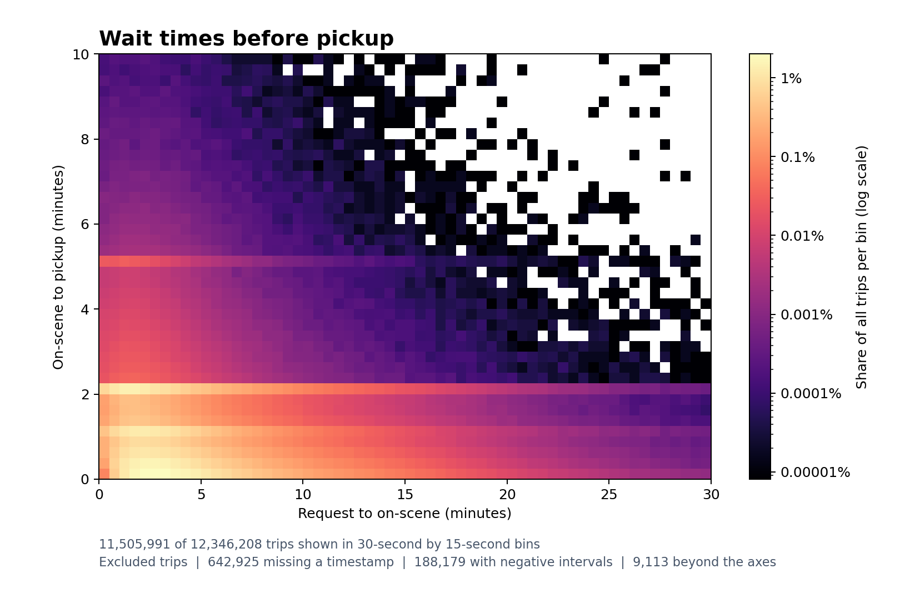

# محتوا گزارش
## اصلاحیه از فاز 1 
- در پروسه فاز 2 متوجه شدم که، سوال time series که در فاز 1 تعریف کردم غلط بوده. 
- سوال جدید time series : 
  بیایم ببینم در هر ساعت روز راننده کجا باشه درامدش بهتره، یعنی یه مدل این داده رو به ما بده، بر حسب pickup line، و زمان ، ببینیم مقدار "درامد تقسیم بر (زمان سفر + 5 )" چقدر میشه. 5 دقیقه زمان پرت هر سفر میگیرم، دقت کنید request time رو داریم ولی زمانی که راننده سفر رو قبول کرده نداریم. ولی از سمتی، راننده از زمانی که یک سفری رو قبول میکنه درگیرش میشه، و زمانی که راننده تا مسیر مسافر رو طی میکنه، تابعی از محله نیست. و یک چیز ثابته، خطای قابل قبولیه چون بخش کوچکی (در حدود 30 درصد) از زمان رو کل صفر رو تشکیل میدن: 
  ![[Pasted image 20261124182402.png]]
## ساخت زنجیره ی پیش پردازش

## مدیریت داده ی گمشده

- یسری شرط های بیسیک رو چک کردیم و تعداد داده هایی که حداقل یک داده رو ندارن بررسی میکنیم، اگر درصدشون کم بود، میریزیم دور.
- یه نکته دیگه هست یسری داده اگه چیزی داخلشون نباشه، یه معنی ای میده ، مثلا صفر
- یک مسئله مهم اینه که ON SCENE دیتا حدودا برای 0.2 از صفر ها موجود نیست
  - ایا pickup time نماینده خوبی است؟؟
- بنظرم با توجه به عکس
  
  در زمان منتظر موندن راننده ، تابعی از مقدار زمان منتظر موندن مسافر نیست ، و یه مقدار ثابت است
- کلا اوبر و لیفت 100  درصد دیتا رو دارند که لیفت دیتا ای که ما میخوایم رو گزارش نکرده
- توزیع رو که نگاه کردیم، تفاوت معنا داری روی محله بر حسب سهم بازار اوبر ندیدیم پس میشه از اوبر استفاده کرد
-
# نحوه سند نویسی

- به همون تریبتی که در گزارش تعریف پروژه اومده ، فقط باید بخش "اصلاحیه از فاز 1 " به ابتدای سند اضافه شود